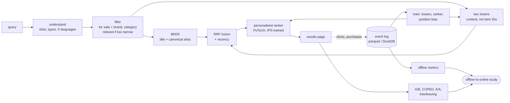
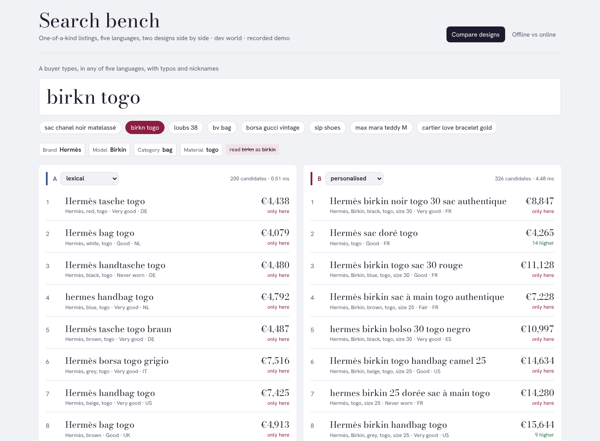

# preloved-search-stack

Multistage composable search for a pre-loved luxury marketplace where every item is one of a kind: multilingual query
understanding, hybrid OpenSearch + vector retrieval, personalised PyTorch re-ranking, and an offline-to-online
framework that tests which offline metrics predict A/B results.

Built by [Manoj Kumar Prakash](https://www.linkedin.com/in/manoj-kumar-prakash-52b7a01b6/) as a portfolio project
for the Senior Data Scientist / Applied Scientist role in Discovery at Vestiaire Collective. The marketplace is
simulated (see [Limits](#limits)); the code is written to run against a real one.

## The problem

A resale catalogue breaks the assumptions most search and recommendation stacks are built on:

- **Every item sells once.** An embedding per item ID never gets enough clicks, and a search that ranks a sold bag
  first is a dead end. Retrieval has to work from what the listing says, and only from what is still for sale.
- **Sellers write titles in their own language.** A French seller's "Sac Timeless cuir noir" has no word in common
  with an Italian buyer's "borsa chanel nera". Attributes the seller filled in are missing or wrong some of the time.
- **Buyers type nicknames and typos.** "loubs 38", "bv bag", "birkn togo".
- **Offline metrics come from the old ranking's logs.** Clicks only exist on what today's search showed, at the
  positions it showed them. A team needs to know which offline numbers it can trust before it spends A/B traffic.

## What is here



- **Composable stages, a design is config** ([ADR 1](docs/adr/0001-composable-stages.md)). `config/designs.toml`
  holds 7 designs and 5 variants; one `Stack.search` serves all of them, and so does the FastAPI service.
- **Query understanding** (`search/qu.py`): longest-phrase matching of brands, models, categories, colours,
  materials, styles and sizes in English, French, German, Italian and Spanish; bounded edit-distance spelling
  correction; ambiguous model names ("kelly", "love") need their brand.
- **Retrieval**: BM25 over the title plus canonical slot tokens (`brand:chanel`), and a content two-tower model
  ([ADR 2](docs/adr/0002-content-tower-not-item-ids.md)) trained in PyTorch on clicks and purchases, served from
  NumPy. The production equivalent is the OpenSearch mapping and query in `search/index.py`.
- **Re-ranking**: an MLP over 18 features (match, price against the buyer's usual price, condition, age, market,
  the buyer's brand and category history), trained listwise and weighted against position bias estimated from 5%
  randomised traffic ([ADR 3](docs/adr/0003-unbiased-ranker.md)).
- **Measurement** (`measure/`): offline replay metrics with point-in-time availability, A/B tests on a ratio metric
  with the delta method and CUPED, A/A false-positive rates, team-draft interleaving, and the study that scores each
  offline metric by how well it predicts the rollout ([ADR 4](docs/adr/0004-offline-to-online.md)).
- **The simulated marketplace** (`world/`): 14,000 starting listings and 900 new ones a day, 6,000 buyers in seven
  markets with hidden tastes, budgets and sizes, position-biased attention, and one purchase per item. Every random
  draw is keyed by search, item and day, so every design is compared on the same buyers and the same luck.

## Results

The dev world (seed 41) shaped every decision; the held-out world (seed 977, a messier catalogue) ran once at the end
([docs/heldout.md](docs/heldout.md)).

<!-- dashboard:start -->
### Headline

| | dev |
|---|---:|
| purchases per search, `personalised` vs `lexical`, full rollout | +35.7% |
| revenue per search, same comparison | +17.1% |
| relevant listings in the top 10 (of 10) | 7.9 → 9.9 |
| searches with no results | 0.4% → 0.0% |
| p95 latency per search (one CPU core, Python) | 4.6 ms |
| best offline predictor of the online lift (Kendall τ) | judged_dcg10 (0.67) |
| log-based offline metrics that scored every new design below today's search | 4 of 4 |
| interleaving vs A/B: searches needed for the same verdict | 39× fewer |
| A/A tests called significant at 5% | 5.5% |
| A/B intervals containing the rollout lift (8 splits) | 7 of 8 |
| ships through the gate | yes |

### Every design, rolled out to every buyer (dev world, days 21–25, 8,916 searches each)

| design | what changes | purchases / search | revenue / search | relevant in top 10 | p95 ms |
|---|---|---:|---:|---:|---:|
| **personalised** | + personalised ranker, IPS (proposed) | 0.0721 (+35.7%) | +17.1% | 9.88 | 4.6 |
| `no_relax` | variant: never relax filters | 0.0721 (+35.7%) | +17.1% | 9.88 | 5.1 |
| `biased_ranker` | ablation: ranker without IPS | 0.0708 (+33.1%) | +13.4% | 9.87 | 4.4 |
| `shallow_rerank` | variant: rerank top 30 only | 0.0703 (+32.3%) | +18.4% | 9.85 | 6.0 |
| `not_personal` | ablation: ranker without buyer history | 0.0700 (+31.6%) | +12.1% | 9.88 | 4.2 |
| `understood` | + query understanding, slot filters | 0.0622 (+17.1%) | +10.4% | 9.35 | 2.5 |
| `hybrid` | + two-tower vectors, RRF | 0.0617 (+16.0%) | +9.7% | 9.51 | 3.8 |
| `id_tower` | ablation: item-ID tower | 0.0607 (+14.1%) | +2.4% | 9.51 | 4.4 |
| `vectors_heavy` | variant: vectors weighted 3x | 0.0592 (+11.4%) | +4.4% | 9.54 | 4.1 |
| `no_fuzzy_filters` | variant: slots as words only, no filters | 0.0585 (+10.1%) | +5.1% | 8.71 | 1.3 |
| `no_recency` | variant: no recency boost | 0.0544 (+2.3%) | +3.2% | 7.94 | 0.7 |
| `lexical` | today: BM25 over the seller's title | 0.0532 (—) | — | 7.90 | 0.7 |

### Which offline metric predicts the online result (dev world, 11 designs and variants, offline on days 18–20)

| offline metric | Kendall τ with the rollout lift | p | right direction vs today | picks |
|---|---:|---:|---:|---|
| judged relevance of the top 10 (rater labels) | 0.67 | 0.005 | 100% | `not_personal` |
| bought item in top 20, against today's tables | 0.41 | 0.085 | 0% | `understood` |
| click nDCG on the logged searches | 0.37 | 0.117 | 0% | `understood` |
| click nDCG, clicks weighted for position | 0.37 | 0.117 | 0% | `understood` |
| bought item in top 20, point in time | 0.24 | 0.307 | 0% | `understood` |

The rollout winner: `personalised`. Offline values per design:

| design | judged_dcg10 | recall_today | ndcg_clicks | ndcg_ips | recall_pit |
|---|---:|---:|---:|---:|---:|
| `lexical` | 0.686 | 0.856 | 0.676 | 0.548 | 1.000 |
| `understood` | 0.818 | 0.774 | 0.587 | 0.487 | 0.868 |
| `hybrid` | 0.813 | 0.679 | 0.528 | 0.435 | 0.790 |
| `personalised` | 0.831 | 0.757 | 0.558 | 0.463 | 0.827 |
| `biased_ranker` | 0.827 | 0.753 | 0.571 | 0.472 | 0.831 |
| `id_tower` | 0.707 | 0.247 | 0.192 | 0.172 | 0.259 |
| `not_personal` | 0.836 | 0.733 | 0.555 | 0.460 | 0.831 |
| `no_recency` | 0.699 | 0.588 | 0.440 | 0.371 | 0.716 |
| `no_fuzzy_filters` | 0.779 | 0.770 | 0.581 | 0.481 | 0.860 |
| `vectors_heavy` | 0.798 | 0.663 | 0.506 | 0.416 | 0.749 |
| `shallow_rerank` | 0.834 | 0.720 | 0.558 | 0.461 | 0.794 |
| `no_relax` | 0.831 | 0.757 | 0.558 | 0.463 | 0.827 |

### Experiments on the proposed design

| | dev |
|---|---:|
| rollout lift (the truth an A/B test estimates) | +35.7% |
| A/B lift, mean over buyer splits (± spread) | +41.0% ± 10.1 |
| A/B splits significant at 5% (CUPED) | 8 of 8 |
| variance removed by CUPED (pre-period purchases) | 0.0% |
| interference: largest change in an arm's purchases vs the same searches in a rollout | 1.3% |
| A/A false positives, plain / CUPED | 5.5% / 5.5% of 1000 |
| interleaving: share of decided searches won by the proposed design | 68.6% |
| searches for an 80%-power verdict, interleaving / A/B | 107 / 4,182 |

### What the models learned

- Position bias (dev), positions 1–5, estimated from the 5% shuffled searches: 1.00, 0.53, 0.37, 0.28, 0.23; the world's true curve: 1.00, 0.54, 0.37, 0.29, 0.23.
- Nicknames no dictionary in the stack contains (dev): share of the content tower's top 50 that is the intended brand: “bv” → Bottega Veneta 100%, “loubs” → Christian Louboutin 98%, “slp” → Saint Laurent 100%.

### Gate (config/stack.toml)

| check | dev |
|---|---|
| ab lower bound | pass |
| zero results | pass |
| p95 ms | pass |

_Generated by `scripts/readme.py` from `reports/*.json`; evaluation ran in 8 min on two cores._
<!-- dashboard:end -->

## What the numbers say

- **Understanding the query is most of the win; personalisation adds a little on top.** Slots as filters and
  canonical tokens take purchases per search up by about a sixth; the ranker roughly doubles that. Removing the
  buyer's own history from the ranker costs a few points; removing the position correction costs a few more. An
  item-ID tower gives up most of the vector gain, because most items sell before they have clicks.
- **Every log-based offline metric preferred today's search.** The logged pages are today's ranking, so any metric
  built from them rewards reproducing it. Among the new designs they still order things somewhat; only judged
  relevance (rater labels, here from the simulation's truth) got the direction right for every design. In practice
  that argues for a small rated query set, and for interleaving before an A/B test.
- **Interleaving reaches a verdict on far fewer searches than an A/B test.** Each buyer compares both rankings on the
  same query, so buyer-to-buyer variance cancels.
- **CUPED did almost nothing here, and the report says so.** Buyers in this world have no lasting propensity to buy
  that last month's purchases reveal. On a real marketplace with repeat buyers the same code should remove much more
  variance; it should be measured before an experiment is sized on it.
- **Interference was small.** With roughly 15,000 items for sale and about 90 purchases a day, one arm of an A/B test
  rarely buys the item the other arm wanted; the report measures it directly, search by search.

## Run it

```bash
python3 -m venv .venv && . .venv/bin/activate
pip install -e ".[train,dev]"
make check        # lint, tests, README matches the reports: seconds
make all          # history -> train -> evaluate -> README, about 12 minutes on two cores
make serve        # FastAPI on :8000   GET /search?q=sac+chanel+noir&design=personalised, /designs, /report
make console      # the React console; reads console/public/demo.json, or the service with VITE_API_URL
```

Airflow (`dags/search_retrain.py`) runs the same scripts nightly and publishes models only when the gate says ship.
`infra/terraform` describes the AWS side (S3 for model artifacts, OpenSearch for listings, ECR for the service image);
CI validates it but never applies it.



## Limits

- **The marketplace is simulated.** Buyers, sellers and their behaviour are a model with stated rules
  (`world/sim.py`, `config/world.toml`). The numbers show how the methods compare under those rules, not what they
  would do at Vestiaire Collective.
- **Scale.** About 33,000 listings and 9,000 searches per evaluated design, against a catalogue of millions. BM25 and
  the vectors run in-process on one core; at scale they would be OpenSearch and a vector index, and latency numbers
  would be those systems'.
- **Judged relevance reads the simulation's truth.** It stands in for a rater panel, which costs money and has its own
  noise.
- **The study has twelve configurations and one marketplace.** Kendall's τ over eleven points has wide intervals; the
  p-values are in the table.
- **No images.** Real listings are judged by their photos; the simulation hides an "appeal" per item that no model
  sees.

## Layout

See [AGENTS.md](AGENTS.md) for the layout, the invariants and the held-out rule, and [SKILLS.md](SKILLS.md) for the
repeatable tasks.
